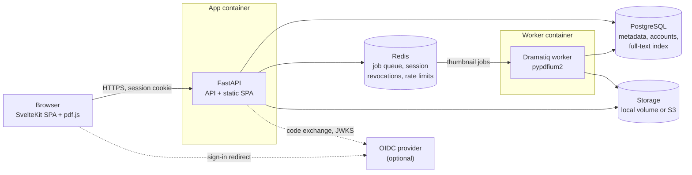
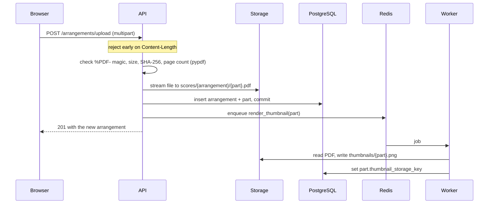

# OpenClef architecture

This document explains how OpenClef is put together and why. For what it does and how to run it,
see the [README](README.md).

## The pieces

One image runs both the API and the worker; only the command differs. The API serves the compiled
SvelteKit app as static files from the same origin, so there is no CORS configuration and a single
port to expose.

## Data model

- An **arrangement** is one piece of music as the library knows it: title, composers, arrangers,
  instruments, key, period, difficulty, tags. There is deliberately no separate "work" layer:
  two arrangements of the same title are told apart by their instrumentation and arranger, the way
  musicians already do.
- A **part** is one PDF belonging to an arrangement: the full score, the cello part, a piano
  reduction. The first part uploaded is the arrangement's cover.
- Tables for **annotations**, **setlists** and **enrichment jobs** exist from the first migration,
  although only enrichment has a (stub) writer today. Adding per-user scoping to annotations later
  would have meant migrating live data; getting the shape right up front costs nothing.

## Ownership and sharing

Every arrangement and setlist has one owner and is private by default. Others reach it three ways:
a one-way **partnership** (the partner sees the sharer's whole library, and it doesn't chain to
the partner's partners), a **group** the item is shared with, or a **shared setlist**, which passes
on each piece only if whoever added it owns it, so a setlist can't be used to hand on music
someone else lent you.

All of that is one function, `services/access.py`, that returns a SQL condition. The library
list, search, facet counts, the detail page, PDF and thumbnail downloads, and setlists all filter
on it, so no endpoint decides visibility for itself. A hidden item answers 404 rather than 403, so
its existence doesn't leak; anyone who can see an item may edit it, while deleting and sharing
belong to the owner (or an admin). The test suite checks every relationship (owner, partner,
reverse partner, partner's partner, group member, setlist audience, stranger, admin) against
every endpoint.

What the library page *lists* is a second, narrower question than what a person can *open*
(`in_library`, always ANDed with the access rule). It lists your own pieces, group shares, and
partners' pieces unless you turned "Show in my library" off for that partner. Pieces reached
only through someone's setlist open from that setlist but aren't listed, and an admin's library
lists the same as anyone's: the admin override is for opening, not for flooding one library with
everyone's music. Keeping the two apart means the toggle can never break a setlist.

Every arrangement field records where its value came from (`field_origins`: user, PDF, file name),
so automatic enrichment can never overwrite something a person typed.

## Upload pipeline

Decisions worth calling out:

- **Validate before storing, store before committing.** Starlette spools the upload to a temporary
  file, so the handler reads it once to check the signature, size and hash, lets pypdf inspect the
  same file, then streams it to storage. Nothing holds the whole PDF in memory, and nothing reads
  it back from storage. If the database commit fails, the stored file is deleted.
- **Oversized uploads are refused before the body is read.** A small ASGI middleware rejects on
  `Content-Length`; the handler re-checks the real byte count for chunked uploads.
- **The job is queued after the commit,** so the worker can never pick up a part that doesn't exist
  yet. If the part is deleted while its thumbnail renders, the worker removes the orphaned PNG.
- **The worker owns its event loop.** Each job runs under its own `asyncio.run()` with a fresh
  database engine and storage client, because asyncpg connections belong to the loop that opened
  them. The worker runs one process and one thread, since PDFium is not thread-safe.

## Search

Postgres does the searching. A generated `tsvector` column over title, subtitle, alternative
titles, composers, arrangers and instrumentation has a GIN index. Each word of the query becomes a
prefix term (`moon:*`), so results narrow while the user is still typing. Only word characters
reach `to_tsquery`, so user input can't inject query operators.

Facet counts (instrument, composer, key, period, difficulty, tag) apply every active filter
**except their own**. After choosing "Romantic", the period facet still lists the other periods,
which is what lets someone change their mind with one click instead of clearing filters.

## Reading scores in the browser

The viewer uses pdf.js directly, without a wrapper component. Each page renders once, at the
screen's pixel density, into an off-screen canvas; turning a page copies that canvas to the
visible one. After every turn the neighbouring pages render ahead. Renders run one at a time to
keep memory flat on tablets, and the cache is rebuilt when the window size or fullscreen state
changes. pdf.js and its worker load only when a viewer or upload preview first needs them.

The upload preview uses the same pdf.js copy to suggest a title, composer and key. Engraving tools
such as LilyPond set music symbols in a music font, and those glyphs reach pdf.js as control
characters or as letters ("pp" for pianissimo), often larger than the real title. The suggestion
code drops those pieces before grouping text into lines, requires real words for a title, prefers
centred lines, and recognises German key names. It is tested against reproductions of real
engraved title pages.

## Accounts and sign-in

- **Sessions** are signed cookies (`itsdangerous`) carrying the user id and a random session id.
  Redis holds only revocations, so a normal request needs no session lookup, and losing Redis
  forgets revocations and rate-limit counters but signs nobody in or out.
- **Passwords** are hashed with Argon2id plus a per-install pepper, and rehashed transparently when
  the cost parameters change. Sign-in is rate-limited per username with a token bucket in Redis.
- **OIDC single sign-on** is optional and provider-agnostic:
  - authorization-code flow with PKCE, `state` and `nonce`, all held in a 10-minute signed cookie,
    so the server keeps no login state between redirect and callback;
  - the ID token's signature is checked against the provider's JWKS (refetched once if keys
    rotate), then its issuer, audience, expiry and nonce;
  - accounts are matched on the provider's `sub` claim only, never on email or username. A name
    clash gets a suffix instead of attaching to an existing account, and linking an existing
    password account is an explicit action by its signed-in owner;
  - membership of a configured group grants admin, and leaving it never demotes, so a change at
    the provider can't lock out the break-glass admin.

## Storage

Storage is a small async protocol (`put`, `get`, `delete`, `head`, `exists`, `ping`) with two
backends: a local directory and any S3-compatible service. With S3, thumbnails go through a local
LRU cache, because a library grid requests dozens of them at once. Object keys are deterministic
(`scores/{arrangement}/{part}.pdf`, `thumbnails/{part}.png`), so the database never stores paths
that depend on the backend.

## Testing

- The backend suite (pytest) runs against a **real** PostgreSQL, Redis and S3 server. Locally,
  testcontainers starts them; in CI, GitLab job services provide them through `OPENCLEF_TEST_*`
  variables. Constraints, the generated search column and S3 behaviour are not things a mock can
  prove.
- The thumbnail worker is tested through Dramatiq's stub broker with a real worker thread.
- OIDC is tested against an in-process fake provider with its own signing key, discovery document,
  key set and token endpoint, including forged signatures, wrong audience, expired tokens, replayed
  nonces and state mismatches.
- The frontend runs svelte-check and Vitest; the title and key heuristics have table-driven tests.
- Test PDFs are generated in the tests. No real scores are stored in the repository.

## Deployment shape

The reference deployment runs on a small Kubernetes cluster managed with Flux: one API Deployment,
one worker Deployment, a private Redis, a shared PostgreSQL, and an S3-compatible object store.
Releases are semantic-version tags; an image tag in the app repository is the whole release
process. Liveness checks a dependency-free endpoint, while readiness checks the database, Redis and
storage, so a brief database outage takes the pod out of rotation without restarting it.
