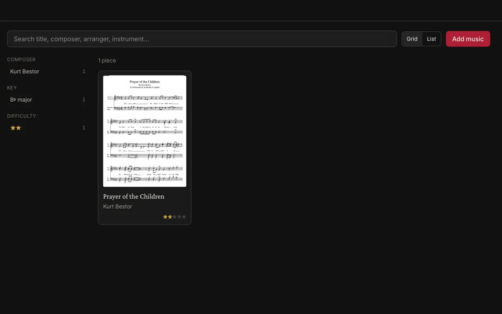

# OpenClef

OpenClef is a self-hosted, web-based library for sheet music PDFs: upload scores, find them with full-text search and facets, and read them in the browser.



**Status:** early and in active development. Accounts (password and optional OIDC), PDF upload, search, the library grid and the page viewer work end to end. Setlists and annotations have database tables but no API or UI yet; a performance mode is planned.

Developed on a self-hosted GitLab; this GitHub repo is a read-only mirror. Issues and pull requests are not accepted here.

## What it does

- **Library and search.** Arrangements are listed in a grid or list with first-page thumbnails. Search is Postgres full-text search over a generated `tsvector` column (title, subtitle, alternative titles, composer, arranger, instrumentation) with a GIN index. Each query word becomes a prefix match, so results narrow as you type, and only word characters reach `to_tsquery`, so input cannot inject query operators. Facets (instrument, composer, key, period, difficulty, tag) return counts computed with every other active filter applied.
- **Upload.** A PDF is validated by magic bytes, size cap and a pypdf parse while being streamed from the spooled multipart file to storage, with a SHA-256 computed on the way; nothing holds the whole file in memory. In the browser, pdf.js reads the PDF's Info dictionary and first-page text to suggest title and composer before upload. Arrangements can have multiple parts (one PDF each).
- **Thumbnails.** A Dramatiq worker renders the first page with PDFium (pypdfium2) after the upload commits. A failed enqueue only means no thumbnail yet.
- **Viewer.** A pdf.js viewer built for reading at the stand: one page at a time fitted to the screen, tap or swipe zones instead of a toolbar, keyboard page turns, and neighbouring pages pre-rendered off-screen so turns are instant.
- **Storage.** A small storage protocol with two backends: local filesystem (async IO via aiofiles) and S3-compatible (aioboto3), with an on-disk LRU cache for thumbnails on S3.
- **Auth.**
  - Argon2id password hashing with a per-install pepper.
  - Signed session cookies that carry identity; Redis stores only a revocation set, so a normal request needs no Redis lookup.
  - Per-username login rate limit as a token bucket in a single Redis Lua script, so check-and-decrement is atomic.
  - Optional OIDC sign-in (any provider): authorization code flow with PKCE, `state` and `nonce` kept in one short-lived signed cookie, ID token verified against the provider's JWKS, users matched on `sub` only. An admin group claim can grant the admin role.
- **First-run setup and admin.** A `/setup` flow creates the first admin; admins manage users. User docs are served inside the app at `/docs`.

## Stack

| Layer | Choice |
|---|---|
| Backend | Python 3.12, FastAPI, SQLAlchemy 2 (async, asyncpg), Alembic, Pydantic 2, structlog |
| Jobs | Dramatiq on Redis |
| Database | PostgreSQL 16 |
| PDF | pypdf (metadata), pypdfium2 (thumbnails), pdf.js (viewer, client-side inspection) |
| Frontend | SvelteKit 2 with Svelte 5, Vite 6, Tailwind 4, TypeScript, built as a static SPA served by FastAPI |
| Deploy | One container image (multi-stage Dockerfile); Docker Compose for local and small installs |

## Run it locally

Requires Docker with Compose.

```bash
git clone https://github.com/mekstromjr/openclef.git
cd openclef
cp .env.example .env
docker compose up -d
```

Open http://localhost:8000 and sign in as `admin` / `password` (dev-only values from `.env.example`). The app container runs database migrations on start; a separate worker container renders thumbnails.

Backend and frontend dev loops, every configuration variable, and the CI layout are in [docs/development.md](docs/development.md).

## Tests and CI

```bash
(cd backend && uv venv -p 3.12 && uv pip install -e '.[dev]' && uv run --no-sync pytest -q)
(cd frontend && npm ci && npm run check && npm test)
```

- **Backend:** 164 pytest tests. Most run against real Postgres, Redis and an S3-compatible server started by testcontainers (Docker required); without Docker those tests skip and the pure unit tests still run. Coverage includes the migration round trip, full-text search and facets, upload validation, both storage backends, sessions, rate limiting and the OIDC flow.
- **Frontend:** `svelte-check` plus Vitest unit tests for the client-side PDF inspection.
- **CI** (GitLab, `.gitlab-ci.yml`): secret detection, `ruff`, the full backend suite with Postgres, Redis and RustFS as job services, the frontend checks, and a Kaniko image build on every merge request and on `main`.

## Repository layout

```
backend/    FastAPI app, Alembic migrations, Dramatiq worker, tests
frontend/   SvelteKit SPA, including in-app docs under src/routes/docs/
docs/       development notes and a frozen Astro Starlight snapshot (see docs/README.md)
```

## License

Apache License 2.0. See [LICENSE](LICENSE).
