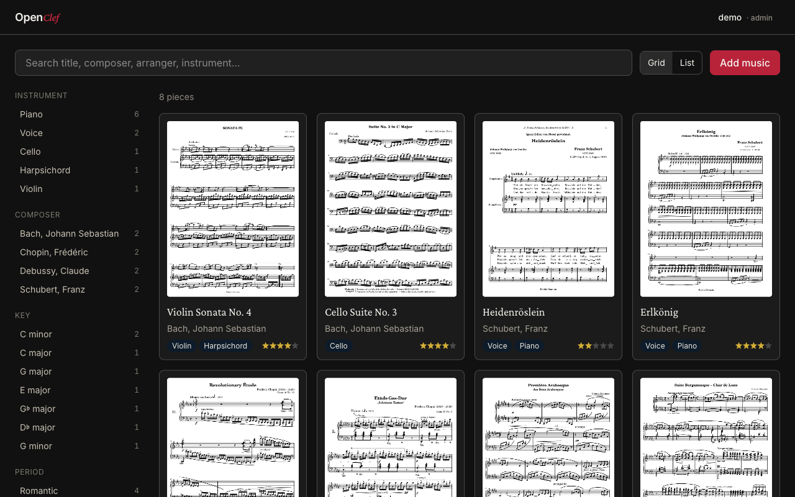
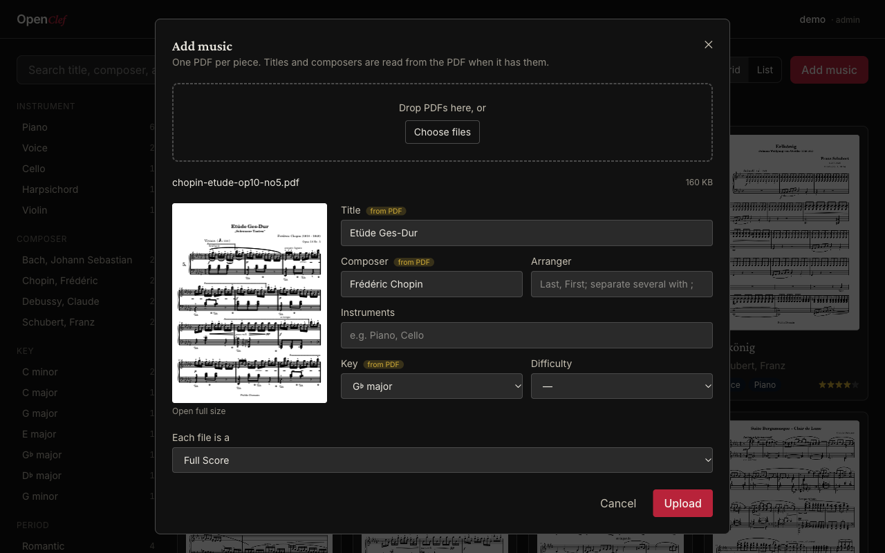
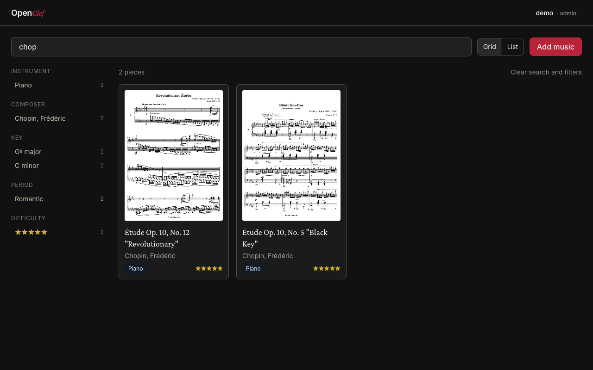
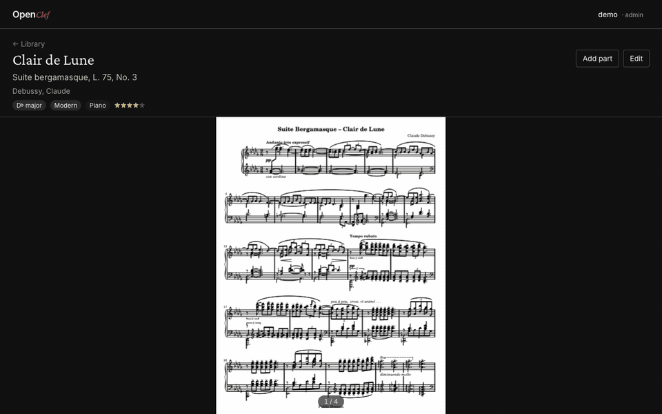

# OpenClef

A self-hosted sheet music library for families and small ensembles. Upload your PDFs once, find
them by title, composer, instrument or key, and read them in the browser with tap-to-turn pages.



OpenClef is the shared shelf that feeds whatever you perform from. Each person keeps their own
library and shares it with the household, so nobody has to email PDFs around before a rehearsal.

**Status:** early and in active development. Accounts (password and optional OIDC), PDF upload,
search, the library, the page viewer and setlists work end to end. Sharing between people
(partners and groups) is being built: the access rules are in place, so for now each account sees
only its own library. Annotations have a database table but no API or UI yet.

Developed on a self-hosted GitLab; this GitHub repository is a read-only mirror. Issues and pull
requests are not accepted here.

## Features

**Library**
- Search as you type over titles, composers, arrangers and instruments: "moon" already finds
  "Moonlight Sonata".
- Filters for instrument, composer, key, period, difficulty and tag, with live counts. A filter
  keeps showing its alternatives, so switching from Piano to Cello is one click.
- Grid or list view. Every filtered view lives in the URL, so it can be bookmarked or shared.

**Scores and parts**
- A piece can hold several parts: the full score, the cello part, a piano reduction.
- All 30 key signatures, spelled the way they're printed (G-flat major is not F-sharp major).

**Upload**
- Drag in one PDF or a whole stack, with per-file progress.
- A live preview of page 1 next to the form, which pre-fills title, composer and key from the
  PDF's metadata and its first page (English and German key names: "in G-flat major", "Ges-Dur").
- Thumbnails render in a background worker, so uploads never wait on them.

**Setlists**
- Put pieces in running order for a rehearsal, service or recital, choosing which part each one
  opens. A setlist reaches whoever can see it; its owner arranges it.
- Play straight through: past the last page of one piece comes the first page of the next, with a
  "Next:" banner and the next PDF already downloaded.

**Score viewer**
- One page at a time, fitted to the screen and sharp on high-density displays.
- Tap the right side (or swipe) for the next page, the left side for the previous one, the top
  strip for a menu with page jump, fullscreen and download. Keyboard: Space, arrows, PageUp/Down.
- Neighbouring pages render ahead, so turns are instant.

**Accounts**
- Native accounts with Argon2id password hashing and rate-limited sign-in.
- Optional single sign-on with any OpenID Connect provider (Authentik, Keycloak, Google...),
  including an admin group mapping. Password accounts remain as break-glass.

| Upload with a live preview | Search as you type |
|---|---|
|  |  |



## Quick start (Docker Compose)

```bash
git clone https://github.com/mekstromjr/openclef.git
cd openclef
cp .env.example .env
docker compose up -d
```

Open <http://localhost:8000> and sign in with the development admin from `.env.example`
(`admin` / `password`). Those values are deliberately weak and for local use only.

The stack runs four containers: the app (API plus the web interface, which runs migrations on
start), a background worker, PostgreSQL and Redis. Uploaded PDFs are stored in the
`openclef-data` volume by default.

### Try it with a demo library

[`scripts/seed_demo.py`](scripts/seed_demo.py) fills an empty instance with eight public-domain
engravings from the [Mutopia Project](https://www.mutopiaproject.org) (Bach, Chopin, Debussy,
Schubert), with full metadata. It uses only the Python standard library:

```bash
OPENCLEF_PASSWORD=password python3 scripts/seed_demo.py --url http://localhost:8000 --username admin
```

The screenshots in this README come from that demo library.

## Configuration

Everything is configured with `OPENCLEF_*` environment variables. The ones you will touch first:

| Variable | Purpose |
|---|---|
| `OPENCLEF_SECRET_KEY`, `OPENCLEF_PEPPER` | Session signing key and password pepper. **Required in production.** |
| `OPENCLEF_STORAGE_BACKEND` | `local` (a volume) or `s3` (any S3-compatible store: AWS, Garage, MinIO, R2) |
| `OPENCLEF_OIDC_ISSUER`, `_CLIENT_ID`, `_CLIENT_SECRET`, `_REDIRECT_URI` | Set all four to show a "Sign in with ..." button for any OpenID Connect provider |
| `OPENCLEF_OIDC_ADMIN_GROUP` | Members of this group (from the `groups` claim) become admins |

The full list with defaults, plus the backend and frontend dev loops and the CI layout, is in
[docs/development.md](docs/development.md).

## Tech stack

| Layer | Choice |
|---|---|
| Backend | Python 3.12, FastAPI, SQLAlchemy 2 (async), Alembic, Pydantic 2, structlog |
| Background jobs | Dramatiq on Redis; pypdfium2 renders thumbnails |
| PDF handling | pypdf (page count, metadata) on the server; pdf.js in the browser |
| Database | PostgreSQL 16, with a generated `tsvector` column and GIN index for search |
| Storage | Pluggable: local filesystem or S3-compatible, with a local thumbnail cache |
| Frontend | SvelteKit with Svelte 5 runes, TypeScript, Tailwind CSS 4, served as a static SPA by FastAPI |
| Auth | Argon2id + signed session cookies; optional OIDC (PKCE, verified ID tokens) |
| CI | GitLab CI: ruff + pytest against real Postgres, Redis and S3 services; svelte-check + Vitest; image build |

[ARCHITECTURE.md](ARCHITECTURE.md) explains how the pieces fit together and why.

## Development and tests

```bash
(cd backend && uv venv -p 3.12 && uv pip install -e '.[dev]' && uv run --no-sync pytest -q)
(cd frontend && npm ci && npm run check && npm test)
```

The 164 backend tests run against real Postgres, Redis and an S3-compatible server, started by
testcontainers locally (Docker required) and as job services in CI. See
[docs/development.md](docs/development.md) for running each piece on its own.

## Repository layout

```
backend/    FastAPI app, Alembic migrations, Dramatiq worker, tests
frontend/   SvelteKit SPA, including in-app docs under src/routes/docs/
docs/       development notes and a frozen Astro Starlight snapshot (see docs/README.md)
scripts/    demo-library seeding
```

## Roadmap

- **Phase 1, Library:** upload, parts, search, viewer, accounts and SSO.
- **Sharing** (in progress): personal libraries shared with partners (one-way, like Immich's
  partner sharing) and groups; shared setlists that pass on what each contributor owns.
- **Phase 2, Performance** (in progress): setlists are done; next are an offline performance
  mode, page turns from Bluetooth pedals, and per-user annotations (the schema already has the
  table).
- **Ideas being explored:** reading titles and key signatures from scanned pages with a vision
  model; optional metadata lookups from MusicBrainz.

## License

Apache 2.0, see [LICENSE](LICENSE).

Demo scores and the screenshots made from them: engravings from the
[Mutopia Project](https://www.mutopiaproject.org), each released into the public domain.
